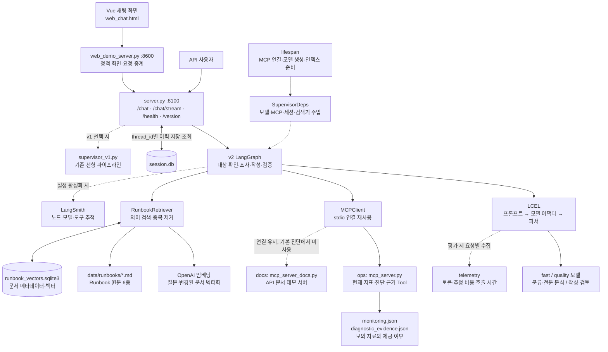
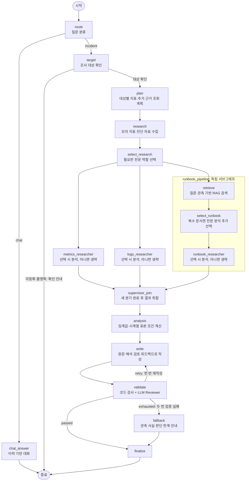
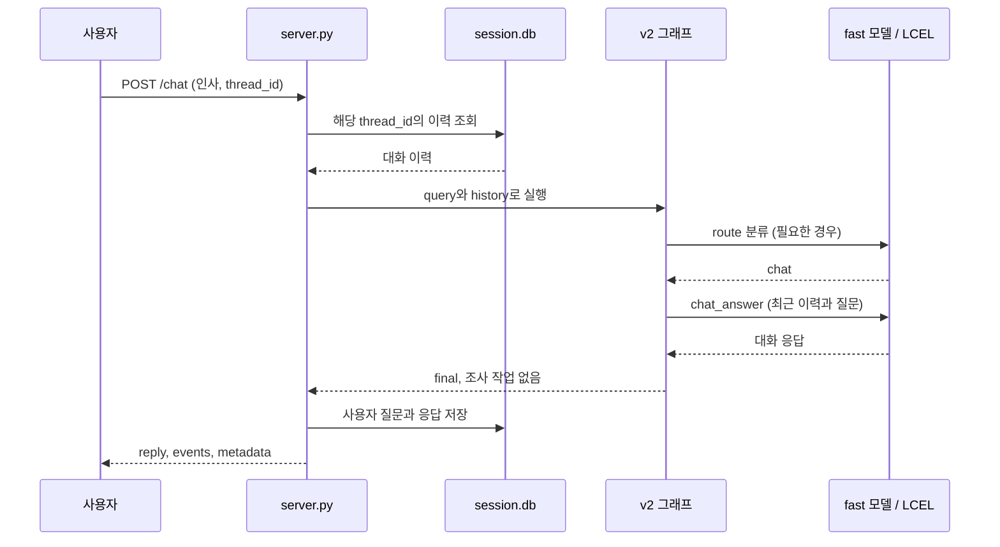
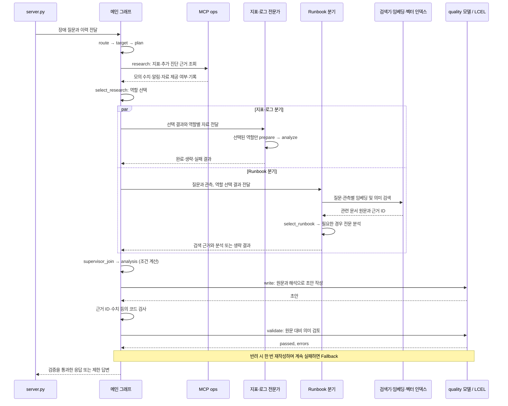
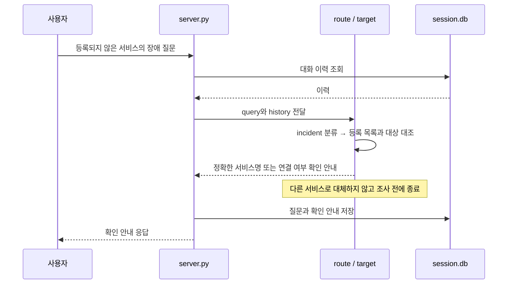
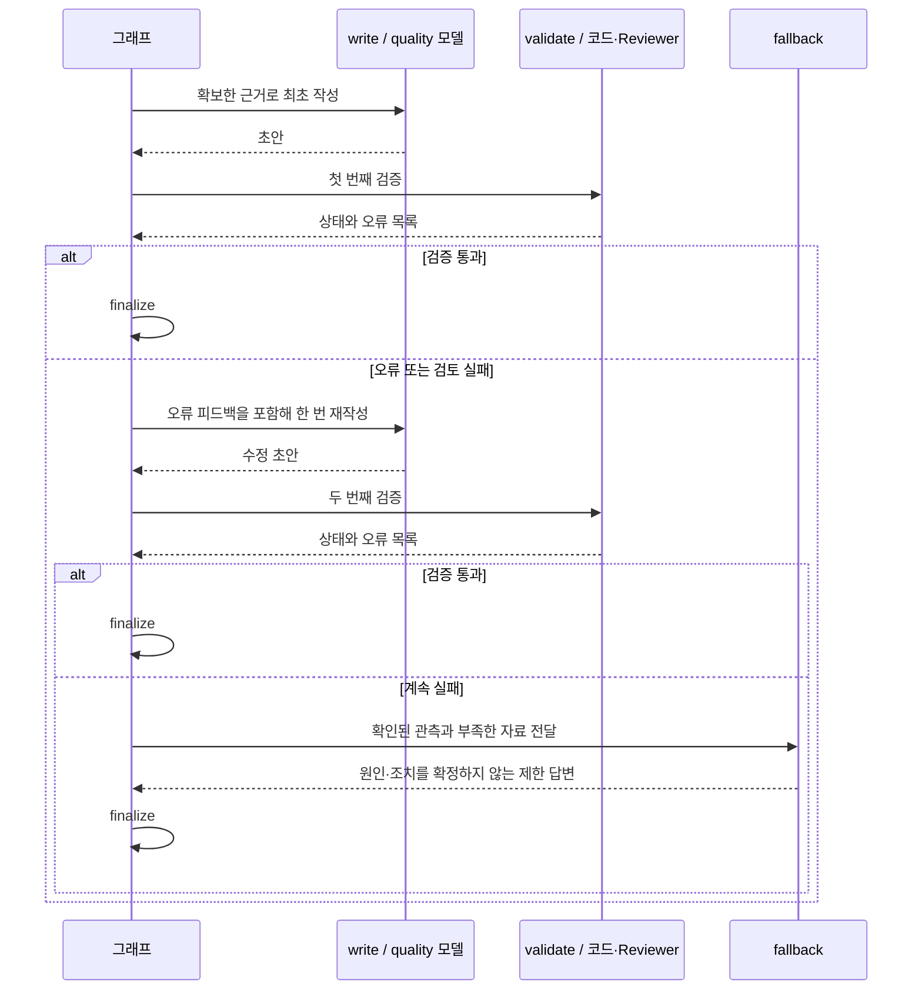
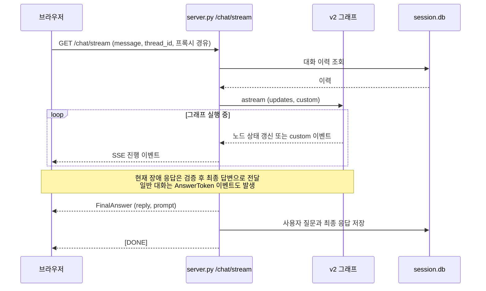
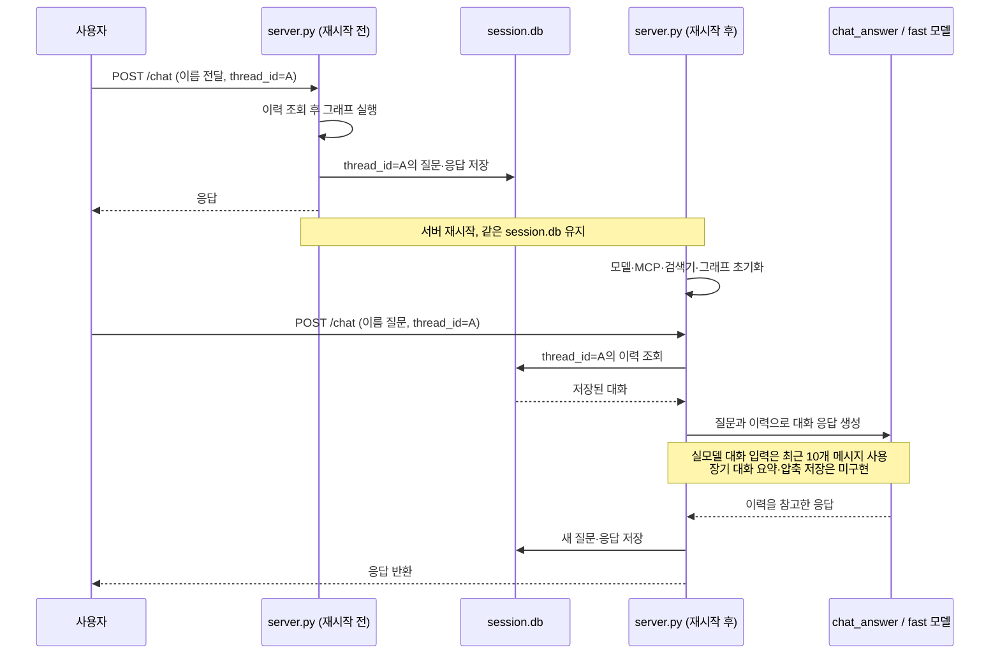
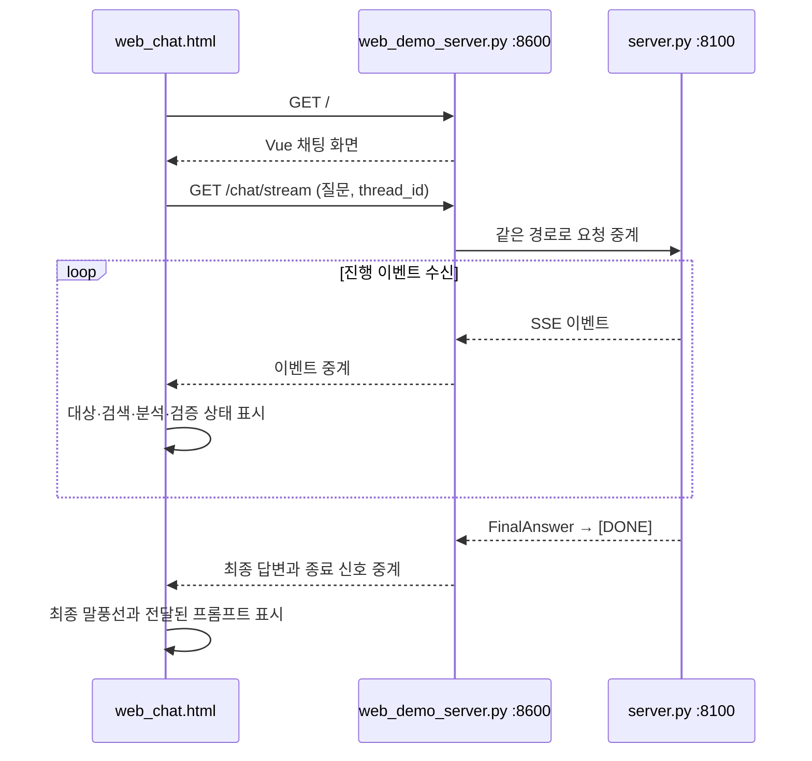

# all_total_vue — 운영 인시던트 대응 에이전트 (Vue 프론트엔드 버전)

> 2026-10-21 개선판: RAG·LCEL에 선택적 전문 분석과 검색/분석 병렬 경로를 적용했다.
> 현재 구조·측정 기록은 [개선 보고서](improvement_report.md), 최초 원본과의 비교 방법은 [평가 안내](../eval/README.md)를 참고한다.
> 중간 실험 파일은 [정리 기록](cleanup_record.md)에 적힌 프로젝트 밖 보관 파일로 옮겼다.
> 아래 구성도와 시퀀스는 현재 v2 코드 기준이며, 기본 multi 경로와 호환 모드를 구분한다.

수업 Base 프로젝트의 FastAPI·MCP·세션 저장 구조에 **RAG, 선택적 멀티에이전트, LCEL, 근거 검증과 Fallback**을 적용한 버전이다. 브라우저는 Vue 3 CDN을 사용하는 단일 HTML 파일로 구성된다.

`LLM_BACKEND`는 fake·ollama·openai를 지원한다. `RESEARCH_MODE`를 지정하지 않으면 fake는 keyword, 실모델은 multi 경로를 선택한다. RAG 임베딩은 현재 OpenAI를 사용하므로 Ollama 모델을 선택해도 rag/multi 모드에는 임베딩 인증과 비용이 필요하다. LangSmith 추적은 설정된 활성화 상태를 따른다.

## 주요 실행 방법

**맨 처음 한 번만**: 이 폴더를 처음 받았다면(학생 배포 등) `.venv`부터 만든다.

```bash
bash sh/setup_venv.sh
```

| 방법 | 명령 | 비용 | 용도 |
|---|---|---|---|
| Python 가상환경 준비 | `bash sh/setup_venv.sh` | 없음 | `.venv` 생성 + `requirements.txt` 설치(최초 1회, 이미 있으면 설치만 재확인) |
| 로컬 Ollama 환경 준비 | `bash sh/setup_ollama.sh` | 없음(로컬 추론) | 모델(`qwen3:0.6b`/`8b`)이 이미 있으면 재사용, 없으면 새로 pull — `OLLAMA_FORCE_REFRESH=1`을 주면 지우고 재구성 |
| 에이전트만 기동 (로컬) | `bash sh/run_agent_ollma.sh` | 로컬 추론 무료, RAG 임베딩 별도 | 서버만 띄워두고 직접 curl/웹으로 테스트 |
| 에이전트만 기동 (OpenAI) | `bash sh/run_agent_openai.sh` | **과금** | 위와 동일하되 실제 API 사용 (y/N 확인) |
| 브라우저 채팅 화면 | `bash sh/run_frontend.sh` (서버 기동 후) | 백엔드에 따름 | `http://localhost:8600`에서 실제 채팅 UI로 사용 |

`run_agent_*.sh`/`run_frontend.sh`는 `.venv`가 이미 있다는 가정 하에 PATH에
꽂아 쓰기만 한다(`.venv`가 없으면 시스템 `python3`로 조용히 떨어져 패키지
누락 오류가 날 수 있다) — `setup_venv.sh`를 먼저 돌려야 하는 이유다.

모든 스크립트는 `.env`가 없으면 `cp .env.example .env` 후 본인 API 키를 채우라는 안내를
출력하고 종료하며(외부 경로에 의존하지 않음 — 이 폴더만 떼어가도 그대로 동작),
LangSmith 프로젝트를 백엔드별로 분리해 기록한다(`capstone-all-total[-ollama|-openai]`).

> 더 쉬운 설명과 실제 캡처 화면이 필요하면 [manual_ollma.md](manual_ollma.md)(로컬
> 실모델) · [manual_openai.md](manual_openai.md)(OpenAI API)를 참고.

## 아키텍처 구성도

### 서비스와 외부 연결

기본 설명은 `SUPERVISOR_VERSION=v2`, `RESEARCH_MODE=multi` 기준이다. MCP의 운영 지표는 모의 데이터이며, Runbook 의미 검색은 MCP 문서 조회 대신 로컬 문서와 벡터 인덱스를 사용한다.



- **초기화와 재사용:** 서버 시작 시 MCP 연결과 의존성을 준비한다. rag/multi에서는 문서 인덱스를 준비하고 변경된 문서만 다시 임베딩한다. 질문 임베딩은 요청마다 수행한다.
- **MCP 사용 범위:** 현재 v2 계획은 코드가 구성하며 MCP Prompt를 조회하지 않는다. 기본 multi 경로는 `get_monitoring_status`와 `get_diagnostic_evidence`를 호출한다. Resource/Prompt 제공 기능은 남아 있고, keyword 경로는 Resource 탐색으로 Runbook을 읽는다.
- **동시 실행 범위:** 자료 수집 노드는 여러 작업을 예약하지만 현재 MCP 클라이언트는 잠금으로 실제 MCP 호출을 직렬화한다. 아래 전문 분석과 검색은 독립 분기로 병렬 실행한다.
- **검증과 계측:** 코드 검사와 LLM Reviewer가 함께 초안을 검토한다. 서비스 메타데이터의 기존 `cost_usd`는 가상 단가이며, 평가용 `estimated_usd`는 입력·출력·캐시 토큰별 추정 비용이다.

### 현재 multi 그래프의 처리 흐름



전문가의 내부 흐름은 `prepare → analyze`이며, 선택되지 않은 역할은 LLM을 호출하지 않는다. Runbook 분석은 검색을 기다리지만 지표·로그 분석의 완료를 기다릴 필요는 없다. 전문 분석 결과는 원문을 대체하지 않으며, 최종 작성자와 Reviewer가 원문 근거를 함께 받는다.

다른 모드는 공통 대상 확인·작성·검증 경로를 유지하면서 조사 이후 흐름만 바뀐다.

- `rag`: `research → retrieve → analysis → write`. 전문 분석 서브그래프를 호출하지 않는다.
- `keyword`: `research → replan_check → analysis → write`. 필요한 규칙 기반 Runbook 작업을 한 차례 추가하면 `research`를 다시 거친다.
- `SUPERVISOR_VERSION=v1`: 위 v2 그래프 대신 기존 선형 파이프라인을 사용한다. 설정 변경은 서버를 다시 시작할 때 반영된다.

## 주요 유스케이스별 고수준 시퀀스 다이어그램

### 1. 가벼운 대화



### 2. 장애 진단과 선택적 멀티에이전트

대상이 명확한 multi 경로다. 역할은 자료 제공 여부·여러 서비스·관측 충돌 등으로 선택하고, 복수 Runbook을 찾으면 검색 후 Runbook 분석을 추가 선택할 수 있다.



### 3. 미등록 또는 불명확한 조사 대상



### 4. 검증 반려와 제한 답변



### 5. 실시간 진행 상황 스트리밍



프론트엔드는 전달된 `TargetChecked`, `RunbooksRetrieved`, `ResearchSelected`, `ResearcherCompleted`, `Validation`, `ValidationLimited` 등의 이벤트를 진행 문구로 표시한다. 전문 분석의 생략은 실패와 구분한다. 진행 이벤트 스트리밍과 모델의 토큰별 실시간 출력을 동일한 기능으로 설명하지 않는다.

### 6. 서버 재시작 후 대화 기억



### 7. 웹 채팅 화면 사용



## 소스 디렉토리 구조

현재 프로젝트 기준이다. 문서 폴더의 실제 이름은 `doc/`이며, 이미지와 반복되는 평가 자료는 폴더 단위로 묶었다.

```text
all_total_vue_student/
├── server.py                       # FastAPI 서버 — 모델·MCP·검색기 초기화, 그래프 실행과 SSE 응답
├── mcp_server.py                   # 운영 MCP 서버 — 모의 지표·진단 근거 조회와 Runbook·프롬프트 제공
├── mcp_server_docs.py              # API 문서 MCP 서버 — 다중 서버 탐색을 위한 데모용 문서 제공
├── web_chat.html                   # Vue 채팅 화면 — 답변과 검색·전문 분석·검증 진행 상태 표시
├── web_demo_server.py              # 프론트엔드 서버(:8600) — 정적 화면 제공과 백엔드 요청 중계
├── requirements.txt                # 프로젝트 실행에 필요한 Python 패키지 목록
├── .env.example                    # 실행 환경과 인증 설정을 작성하기 위한 예시 파일
├── .gitignore                      # 인증 설정·가상환경·세션 DB·벡터 인덱스 등의 Git 제외 규칙
│
├── agent/                          # 현재 에이전트의 실행 로직
│   ├── __init__.py                 # agent 패키지 선언
│   ├── deps.py                     # 모델·MCP·세션·검색기와 실행 모드를 노드에 주입하는 의존성 정의
│   ├── state.py                    # 대상·근거·검증 상태와 병렬 전문 분석 결과의 공유 상태 정의
│   ├── graph.py                    # LangGraph 노드 연결 — keyword/rag/multi 분기와 검증·Fallback 제어
│   ├── nodes/                      # 역할별로 분리한 메인 그래프 노드
│   │   ├── __init__.py             # 노드 패키지 선언
│   │   ├── intake.py               # 질문 분류, 조사 대상 확인과 일반 대화 응답
│   │   ├── research.py             # 조회 계획, 자료 수집, 규칙 검색 보강과 수치 조건 계산
│   │   └── answer.py               # 답변 작성·검증·재작성·제한 답변·최종 응답 처리
│   ├── policies.py                 # 서비스 식별, 자료 부족 판정과 근거 ID·수치·일부 조치 규칙 검사
│   ├── prompts.py                  # 분류·대화·작성·검토·전문 분석에 사용하는 프롬프트
│   ├── chains.py                   # LCEL 기반 프롬프트→모델→파서 연결과 호출 사용량 전달
│   ├── reporting.py                # 원문 근거를 담은 작성 입력 구성과 모의 표시·Fallback 응답 생성
│   ├── retrieval.py                # Runbook 임베딩·SQLite 인덱스 관리와 벡터 유사도 검색
│   ├── researchers.py              # 지표·로그·Runbook 전문 서브그래프와 검색 분기·결과 취합
│   ├── selection.py                # 제공된 자료와 관측 복잡도에 따른 전문 분석 역할 선택
│   ├── telemetry.py                # 호출별 토큰·추정 비용·실행 구간을 요청 단위로 기록
│   ├── openai_llm.py               # OpenAI 모델 호출과 입력·출력·캐시 토큰 사용량 계측
│   ├── ollama_llm.py               # 로컬 Ollama 모델 백엔드
│   ├── fake_llm.py                 # 외부 모델 호출 없이 실행하는 결정론적 실습용 모델
│   ├── mcp_client.py               # 다중 MCP 서버 연결·도구 호출·문서 및 프롬프트 탐색
│   ├── retry.py                    # 일시적 타임아웃에 한정한 대기 후 재시도
│   ├── session_store.py            # SQLite에 대화 이력을 저장하고 조회
│   └── supervisor_v1.py            # 버전 전환용으로 유지하는 기존 선형 파이프라인
│
├── data/                           # 현재 서비스 실행에 사용하는 모의 자료와 검색 설정
│   ├── monitoring.json             # 서비스별 모의 모니터링 기준 수치와 알림
│   ├── diagnostic_evidence.json    # 로그·CPU 시계열·배포 이력의 제공 여부와 모의 기록
│   ├── retrieval_config.json       # 검색 임계값·후보 수·임베딩 모델과 설정 선택 근거
│   ├── runbook_vectors.sqlite3     # 실행 시 생성·재사용하는 문서 임베딩과 메타데이터 저장소
│   └── runbooks/                   # MCP 문서 조회와 RAG 검색에 사용하는 대응 매뉴얼 6종
│       ├── cpu-spike.md             # CPU 급증 확인과 대응 절차
│       ├── db-down.md               # 데이터베이스 장애 확인과 대응 절차
│       ├── disk-full.md             # 디스크 공간 부족 확인과 대응 절차
│       ├── high-latency.md          # 응답 지연 확인과 대응 절차
│       ├── memory-leak.md           # 메모리 문제 확인과 대응 조건
│       └── network-timeout.md       # 네트워크 타임아웃 확인과 대응 절차
│
├── eval/                           # 최초 원본과 현재 버전의 고정 입력 평가 도구·자료
│   ├── README.md                   # 평가 실행·채점·집계 방법과 결과 해석 시 주의점
│   ├── run_evaluation.py           # 고정 MCP 자료로 최초/현재 그래프를 번갈아 실행하고 사용량 측정
│   ├── score_responses.py          # LLM 평가자와 규칙을 이용한 응답 품질·대상·검색 범위 채점
│   ├── summarize_results.py        # 저장된 결과의 품질·토큰·비용·지연 집계와 읽기용 응답 생성
│   ├── evaluate_retrieval.py       # 개발 질문으로 검색 설정을 선택하고 분리된 평가 질문으로 검증
│   ├── validate_dataset.py         # 고정 데이터의 파일 해시·자료 구조·평가 사례 무결성 검사
│   ├── retrieval_cases.json        # 검색 평가용 개발 질문 9개와 평가 질문 12개
│   ├── baseline/                   # 수정하지 않고 보존하는 개선 전 최초 코드
│   │   ├── graph.py                # 최초 LangGraph 흐름과 노드 구현
│   │   ├── openai_llm.py           # 최초 OpenAI 모델 판단·작성 로직
│   │   └── mcp_server.py           # 최초 MCP 서버와 평가에서 사용하는 원본 절차 프롬프트
│   ├── fixtures/                   # Before/After에서 동일하게 제공하는 고정 모의 자료
│   │   └── v1/                     # incident-quality-v1 평가 데이터 버전
│   │       ├── cases.json          # 기본 질문 10개·추가 사례 5개와 관측 자료·질문별 기준
│   │       ├── manifest.json       # 평가 입력 파일의 SHA-256 기록
│   │       └── runbooks/           # 평가 시 고정하여 사용하는 대응 매뉴얼 6종
│   └── results/                    # 보존한 최초 결과·현재 결과·검색 평가 결과
│       ├── before-live/            # 최초 그래프의 33개 응답·채점·실행 메타데이터 원본
│       ├── current/                # 현재 선택적 멀티에이전트의 48개 응답과 관련 기록
│       │   ├── responses.jsonl     # 전체 응답과 근거·노드 흐름·모델 호출·사용량 기록
│       │   ├── scores.jsonl        # 응답별 자동 평가와 대상·검색 결과 채점
│       │   ├── metadata.json       # 측정 설정·코드 해시와 기존 실험에서 추출한 경위
│       │   ├── completion.json     # 보존 응답 수와 원래 실험 완료 시각
│       │   ├── judge_metadata.json # 채점 지침·평가 도구 해시와 평가 방식 기록
│       │   ├── summary.json        # 기본·경계 사례별 품질·사용량·응답시간 요약
│       │   ├── responses_readable.md # 첫 반복의 질문과 최종 답변을 읽기 쉽게 정리
│       │   ├── selection_records.json # 전문 분석의 선택 이유와 완료·생략·실패 기록
│       │   └── manual_quality_notes.json # 원문 점검에서 발견한 남은 오류와 자동 채점의 한계
│       └── retrieval/              # 검색 구성요소의 개발/평가 결과와 인덱스 생성 사용량
│
├── tests/                          # 외부 API 없이 수행하는 회귀 테스트
│   ├── test_grounding.py           # 대상 처리·근거 검증·자료 부족·Fallback·임계값 검사
│   ├── test_rag_multi.py           # LCEL·검색·전문 서브그래프·결과 합류 검사
│   ├── test_selective.py           # 선택적 호출·출력 제한·병렬 실행·복수 인용 처리 검사
│   └── test_evaluation.py          # 최초/현재 평가 실행·계측·요약 도구의 연결 검사
│
├── sh/                             # 환경 준비·서버 실행·배포용 스크립트
│   ├── setup_venv.sh               # Python 가상환경 생성과 패키지 설치
│   ├── setup_ollama.sh             # 로컬 Ollama 모델 준비
│   ├── run_agent_ollma.sh          # Ollama 백엔드 에이전트 서버 실행
│   ├── run_agent_openai.sh         # OpenAI 백엔드 에이전트 서버 실행
│   ├── run_frontend.sh             # 브라우저 채팅 화면 서버 실행
│   └── make_student_zip.sh         # 인증 설정을 제외한 학생 배포용 압축 파일 생성
│
└── doc/                            # 사용 안내·개선 보고서·평가 기준·그래프와 화면 자료
    ├── README.md                   # 프로젝트 안내와 현재 파일 구성
    ├── manual_ollma.md             # 기존 Ollama 사용 가이드
    ├── manual_openai.md            # 기존 OpenAI 사용 가이드
    ├── regression_test_queries.md  # 기본 회귀 질문 목록
    ├── regression_evaluation_criteria.md # 질문별 응답 평가 기준
    ├── before_responses_2026-10-20.md # 초기 화면에서 확보한 Before 응답 기록
    ├── improvement_report.md       # 현재 개선 내용·측정 기록·항목별 코드 위치와 한계
    ├── cleanup_record.md           # 중간 산출물 정리 범위와 임시 복구용 보관 위치
    ├── langgraph_before.mmd        # 최초 그래프 구조
    ├── langgraph_rag_lcel.mmd       # RAG 단독 경로의 그래프 구조
    ├── langgraph_selective_multi.mmd # 현재 선택적 멀티에이전트 그래프 구조
    ├── subgraph_metrics.mmd        # 지표 분석 전문 서브그래프 구조
    ├── subgraph_logs.mmd           # 로그 분석 전문 서브그래프 구조
    ├── subgraph_runbook.mmd        # Runbook 분석 전문 서브그래프 구조
    ├── selective_multi_ui.png      # 현재 검색·분석·검증 흐름의 화면 확인 자료
    ├── image_usecase/              # 기존 Ollama 사용 가이드의 화면 이미지
    └── image_usecase_openai/       # 기존 OpenAI 사용 가이드의 화면 이미지
```

로컬 실행 설정 `.env`, 가상환경 `.venv/`, 대화 이력 `session.db`, Python 캐시는 위 소스 목록에서 생략했다. 평가 결과의 해석과 최초/현재 재비교 절차는 [평가 안내](../eval/README.md)를 참고한다.
